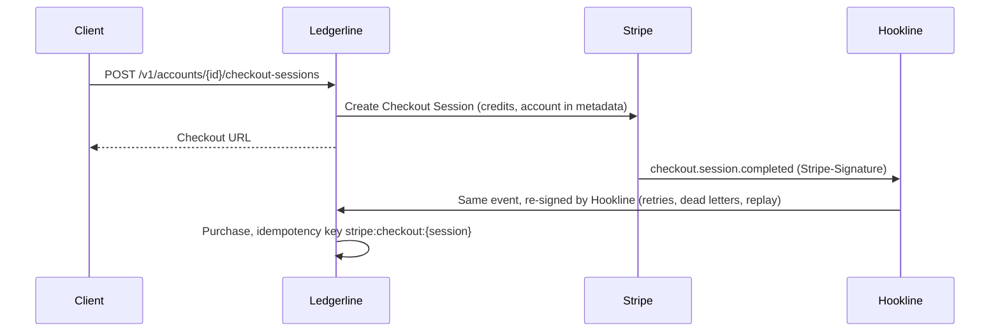

# Ledgerline

[](https://github.com/sufian07/ledgerline/actions/workflows/ci.yml)

A double-entry credits ledger in TypeScript and PostgreSQL. Customers buy credits, spend them, and get refunds; every change is recorded so balances can always be rebuilt and checked.

Status: done and deployed. Live API: [ledgerline-5omj.onrender.com](https://ledgerline-5omj.onrender.com/openapi.json) (free plan: the first request after a quiet spell takes about a minute). The API needs a key, so the public view is the [OpenAPI description](https://ledgerline-5omj.onrender.com/openapi.json) and [health check](https://ledgerline-5omj.onrender.com/health).

## How it works

Every change is an **entry** made of **postings** that sum to zero:

| Entry | Postings |
|---|---|
| Purchase of 100 | payments −100, customer +100 |
| Spend of 30 | customer −30, revenue +30 |
| Refund of 20 | customer −20, payments +20 |

`payments` and `revenue` are system accounts. `payments` goes negative by design: it represents money that came in from outside.

## Guarantees

PostgreSQL enforces the rules, so a bug in the application cannot break them:

- **Balanced entries:** a deferred constraint trigger rejects any entry whose postings don't sum to zero at commit.
- **Append-only history:** triggers block updates and deletes on entries and postings.
- **No negative customer balances:** a check constraint, plus a conditional `UPDATE` that fails instead of overdrawing.
- **Refunds never exceed their purchase:** the purchase row is locked first, so refunds of it run one at a time.
- **Exactly once:** each request carries an idempotency key. A repeat returns the original result; reusing a key for a different request is refused.
- **Checkable:** `verify()` recomputes every balance from the postings and reports any that disagree.

These are tested against a real PostgreSQL, including under concurrency: 50 simultaneous spends against 20 credits (exactly 20 succeed), 20 simultaneous copies of one request (applied once), and 10 simultaneous refunds of one purchase (never more than it).

## Payments

Customers buy credits through Stripe Checkout, and the account is credited when Stripe confirms payment:



- **Exactly once:** both `checkout.session.completed` and `checkout.session.async_payment_succeeded` for a session map to one idempotency key, so redeliveries never credit twice.
- **Two ways in:** `/webhooks/hookline` takes events relayed by [Hookline](https://github.com/sufian07/hookline), which verifies Stripe's signature and handles retries and replay. `/webhooks/stripe` takes events straight from Stripe. Both check a signature and a 5-minute timestamp window.
- **Failures stay visible:** a paid checkout that cannot be applied (unknown account, bad metadata) answers 422, so the sender retries it and, through Hookline, it ends up as a dead letter that can be replayed.
- **No SDK:** Checkout sessions are created with one `fetch` call to Stripe's REST API, passing the client's idempotency key through.

Without Stripe settings the ledger still works, and checkout answers 503.

| Variable | Purpose |
|---|---|
| `STRIPE_SECRET_KEY` | Test-mode secret key (`sk_test_...`) for creating Checkout sessions |
| `STRIPE_WEBHOOK_SECRET` | Signing secret of a Stripe webhook endpoint pointed at `/webhooks/stripe` |
| `LEDGERLINE_HOOKLINE_SECRET` | Signing secret of the Hookline subscription pointed at `/webhooks/hookline` |
| `LEDGERLINE_CREDIT_PRICE_CENTS`, `LEDGERLINE_CURRENCY` | Price per credit; defaults 10 and `usd` |

## API

Every `/v1` request needs `Authorization: Bearer $LEDGERLINE_API_KEY`. The full description is served at `/openapi.json` (OpenAPI 3.1, written by hand; a spec checks every documented operation exists).

| Method | Path | Notes |
|---|---|---|
| `POST` | `/v1/accounts` | `{ "code": "cust_42" }` |
| `GET` | `/v1/accounts`, `/v1/accounts/{id}` | Balance included |
| `GET` | `/v1/accounts/{id}/entries` | Newest first |
| `POST` | `/v1/accounts/{id}/purchases` | `{ "amount": 100 }` |
| `POST` | `/v1/accounts/{id}/spends` | `{ "amount": 30, "reference": "lead_9" }` |
| `POST` | `/v1/purchases/{id}/refunds` | `{ "amount": 20 }` |
| `POST` | `/v1/accounts/{id}/checkout-sessions` | `{ "credits": 250, "successUrl": "...", "cancelUrl": "..." }`; returns the Stripe Checkout URL |
| `GET` | `/v1/entries/{id}` | |
| `GET` | `/v1/ledger/verify` | Recomputes balances and reports drift |
| `GET` | `/health` | Public; checks the database |

- **Idempotency:** purchases, spends and refunds need an `Idempotency-Key` header. A repeat returns the original result with `200` and `Idempotent-Replayed: true`; a new entry returns `201`.
- **Paging:** lists return `{ "data": [...], "nextCursor": ... }`. Pass `cursor` for the next page and `limit` (up to 100).
- **Errors:** always `{ "error": { "code", "message" } }`. Codes: `invalid_request` (400), `unauthorized` (401), `account_not_found`, `purchase_not_found`, `entry_not_found` (404), `duplicate_account`, `idempotency_conflict` (409), `payload_too_large` (413), `insufficient_credits`, `refund_exceeds_purchase`, `invalid_payment_event` (422), `payment_provider_error` (502), `payments_not_configured` (503).

```sh
curl -X POST localhost:3000/v1/accounts/$ACCOUNT/purchases \
  -H "Authorization: Bearer $LEDGERLINE_API_KEY" -H "Content-Type: application/json" \
  -H "Idempotency-Key: order-1001" -d '{"amount":100}'
```

## Run

```sh
npm ci
npm run build
DATABASE_URL=postgres://... npm run db:migrate
DATABASE_URL=postgres://... LEDGERLINE_API_KEY=at-least-16-characters npm start
```

## Run the tests

```sh
npm ci
npm test
```

Without `DATABASE_URL`, the tests start a throwaway PostgreSQL 18 with `embedded-postgres`. CI runs them against a PostgreSQL 18 service container, then builds the Docker image and checks it end to end: it refuses to start without an API key, credits a Hookline-signed payment once, and keeps its data across a restart.

## Deployment

`render.yaml` deploys a free web service and a free PostgreSQL 18 on Render, after CI passes on `main`. The container runs migrations, then starts the server (free services have no pre-deploy step).

To try a real Stripe test-mode purchase end to end, run `script/try-checkout.ps1 -BaseUrl <service URL>`. It reads the API key from `.env`, starts a Checkout, waits while you pay with Stripe's test card, and shows the credited balance.

Free-plan limits: the service sleeps after 15 minutes idle (the next request takes about a minute), and free PostgreSQL expires 30 days after creation, with no backups. That suits a demo, not real money.

## Stack

Node.js 24, TypeScript, NestJS, Kysely, PostgreSQL 18, Vitest.
